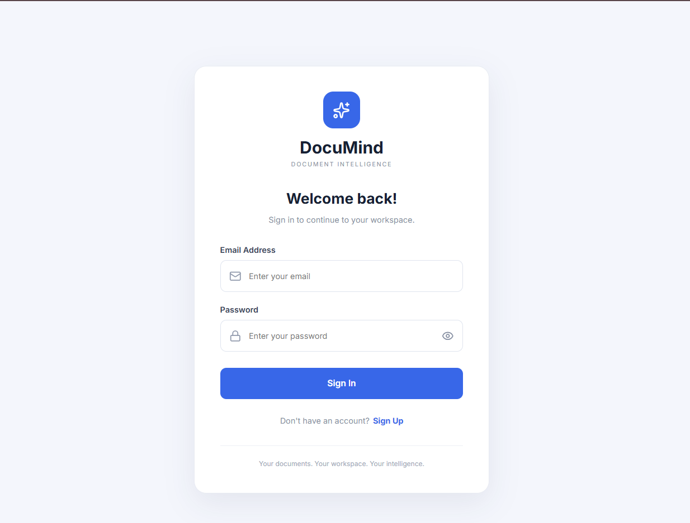
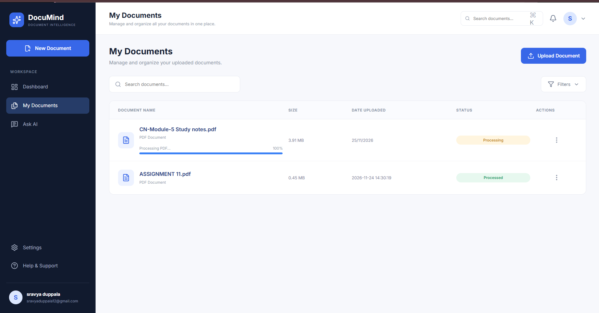
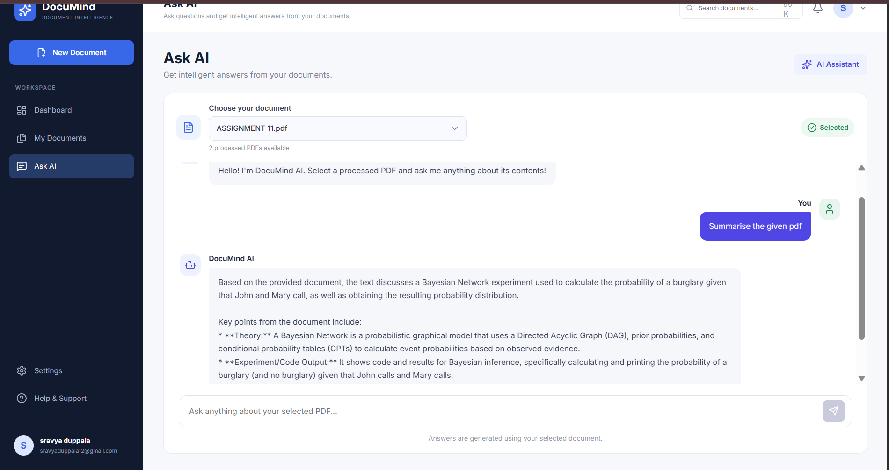
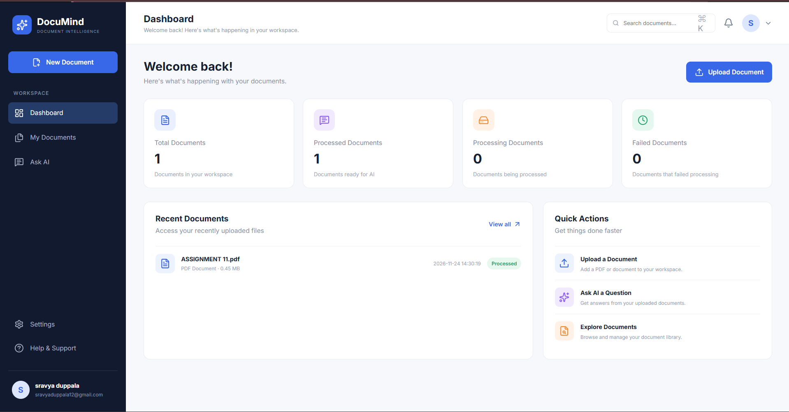

# DocuMind AI — AI-Powered Document Intelligence

DocuMind AI is a full-stack document intelligence platform that allows users to upload PDF documents, ask questions in natural language, and receive context-aware answers using **Retrieval-Augmented Generation (RAG)**.

The application combines semantic search, vector embeddings, and Google Gemini to make information retrieval from documents easier and more interactive.

## Features

- **User Authentication** — User registration and login with JWT-based authentication.
- **PDF Upload** — Upload and process PDF documents.
- **Document Intelligence** — Extract and split document text into manageable chunks.
- **Semantic Search** — Retrieve relevant information using vector embeddings.
- **AI-Powered Q&A** — Ask natural-language questions and receive answers grounded in document context.
- **Document Preview** — Preview uploaded PDF documents.
- **Document Management** — Delete documents from your library.
- **User-Specific Libraries** — Keep document access separated by user account.

## Application Screenshots

### Login


### My Documents


### Ask AI


### Dashboard


## Technology Stack

| Layer | Technologies |
|---|---|
| Frontend | React, Vite, JavaScript, CSS, Lucide React |
| Backend | Python, FastAPI |
| Database | SQLite |
| Authentication | JWT, Argon2 password hashing |
| PDF Processing | PyMuPDF, Tesseract OCR, Pillow |
| Embeddings | Sentence Transformers |
| Vector Database | ChromaDB |
| Generative AI | Google Gemini API |

## How It Works

1. A user registers or logs into DocuMind AI.
2. The user uploads a PDF document.
3. The backend extracts text from the PDF and divides it into chunks.
4. Sentence Transformers generate vector embeddings.
5. ChromaDB stores the document embeddings.
6. Semantic search retrieves relevant chunks based on the user's question.
7. Google Gemini generates a context-aware answer using the retrieved content.

## Project Structure

```text
DocuMind-AI/
├── backend/
│   ├── app.py
│   ├── auth.py
│   ├── auth_routes.py
│   ├── database.py
│   ├── embedding_generator.py
│   ├── pdf_reader.py
│   ├── rag_qa.py
│   ├── semantic_search.py
│   ├── text_chunker.py
│   └── vector_store.py
│
├── frontend/
│   ├── src/
│   │   ├── components/
│   │   ├── pages/
│   │   ├── App.jsx
│   │   └── main.jsx
│   └── package.json
│
├── screenshots/
│   ├── Login.png
│   ├── My-Documents.png
│   ├── Ask-Ai.png
│   └── Dashboard.png
│
├── .env.example
├── .gitignore
└── README.md
```

## Getting Started

### Prerequisites

- Python 3.11 or newer
- Node.js and npm
- Tesseract OCR
- Google Gemini API key

### 1. Clone the Repository

```bash
git clone https://github.com/sduppala-commits/DocuMind-AI.git
cd DocuMind-AI
```

### 2. Set Up the Backend

Create and activate a virtual environment:

```bash
python -m venv .venv
```

On Windows PowerShell:

```powershell
.venv\Scripts\Activate.ps1
```

Install dependencies:

```bash
pip install -r backend/requirements.txt
```

Create a `.env` file in the project root using `.env.example` as a reference. Add your own Gemini API key and JWT secret. Never upload your `.env` file to GitHub.

Run the backend:

```bash
python -m uvicorn backend.app:app --reload
```

### 3. Set Up the Frontend

Open another terminal:

```bash
cd frontend
npm install
npm run dev
```

Open the local frontend URL displayed in the terminal.

## Team

- **Sravya** — Frontend development, UI/UX, API integration, and testing.
- **Tulasi** — Backend development, RAG pipeline, and AI integration.

## Project Status

**Locally runnable project.**

The core application features have been developed and tested locally. Public deployment of the original React and FastAPI application is not yet available.

## Future Improvements

- Public deployment
- Persistent cloud storage
- Expanded document format support
- Improved document retrieval and response evaluation
- Additional testing and performance improvements